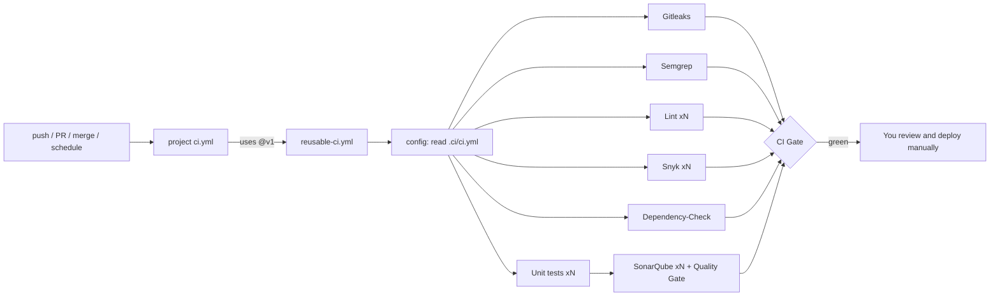

# ci-templates: a centralized, reusable CI framework (quality and security only, NO deployment)

One central repo holds every check. Each project adds **two small files** and gets lint, unit tests with coverage, SonarQube, Snyk, OWASP Dependency-Check, Semgrep SAST and Gitleaks secret detection, all running in parallel.
**Nothing in this repo deploys, publishes, releases or connects to a server.** Deploy manually after the `CI Gate` check is green.

---

## ⚡ 10-minute quick start

```bash
# 1. Create the central repo (e.g. github.com/<you>/ci-templates), unzip this into it, then:
./scripts/init-central-repo.sh <your-github-user-or-org>     # replaces R0be1 everywhere
git add -A && git commit -m "CI templates v1" && git push
git tag v1 && git push origin v1

# 2. If ci-templates is PRIVATE: Settings → Actions → General → Access →
#    "Accessible from repositories owned by <you>"   (required, or callers get "workflow not found")

# 3. In each project repo:
mkdir -p .github/workflows .ci
cp <ci-templates>/examples/caller/.github/workflows/ci.yml .github/workflows/ci.yml
cp <ci-templates>/examples/<your-stack>/.ci/ci.yml          .ci/ci.yml   # edit names/paths
git add -A && git commit -m "Add CI" && git push

# 4. Add secrets (only for tools you enable): SONAR_TOKEN, SONAR_HOST_URL, SNYK_TOKEN, NVD_API_KEY
# 5. Branch protection on main → require status check "ci / CI Gate"
```

Gitleaks, Semgrep, Dependency-Check, lint and tests work **with zero secrets**. Sonar and Snyk are `enabled: false` by default; turn them on once their tokens exist.

---

## 1. Architecture

```
  PROJECT REPO (any stack)                         CENTRAL REPO: ci-templates (tag v1)
 ┌─────────────────────────────────┐   uses   ┌────────────────────────────────────────────┐
 │ .github/workflows/ci.yml (same  │ ───────▶ │ .github/workflows/reusable-ci.yml          │
 │   file in every repo)           │          │   └─ uses composite actions:               │
 │ .ci/ci.yml (components +        │          │      actions/setup-stack  (runtime+cache)  │
 │   thresholds)                   │          │      actions/lint                          │
 └─────────────────────────────────┘          │      actions/unit-test   (coverage)        │
                                              │      actions/sonar-scan  (quality gate)    │
                                              └────────────────────────────────────────────┘

 Job graph inside reusable-ci.yml (everything after `config` runs in parallel)

  config ──┬── secret-scan        Gitleaks (repo-wide, incremental on PR/push)       ──┐
           ├── sast               Semgrep CE (repo-wide, only NEW findings on PRs)   ──┤
           ├── lint        [×N]   one job per component                              ──┤
           ├── unit-tests  [×N] ──► sonarqube [×N] (reuses coverage, Quality Gate)   ──┼──► CI Gate  ◄── the ONE required check
           ├── snyk        [×N]   SCA per component (PRs + pushes)                   ──┤
           └── dependency-check   OWASP DC (push/schedule; cached NVD DB)            ──┘
                                                       NO deploy / release / publish stages
```



## 2. Central repo structure

```
ci-templates/
├── .github/
│   ├── workflows/
│   │   ├── reusable-ci.yml        ← the pipeline (workflow_call)
│   │   └── self-test.yml          ← actionlint on this repo
│   └── dependabot.yml             ← keeps the actions it uses up to date
├── actions/
│   ├── setup-stack/action.yml     ← node|python|java|dotnet runtime + dependency cache + install
│   ├── lint/action.yml
│   ├── unit-test/action.yml
│   └── sonar-scan/action.yml
├── examples/
│   ├── caller/.github/workflows/ci.yml   ← copy into every project unchanged
│   ├── node-nestjs/ nextjs/ react-vite/ aspnet-core/ spring-boot/ python/ fullstack/  (.ci/ci.yml)
├── templates/
│   ├── ci.yml                     ← every config key, with defaults
│   ├── .gitleaks.toml
│   ├── dependency-check-suppressions.xml
│   └── sonar-project.properties
└── scripts/
    ├── init-central-repo.sh       ← replaces R0be1
    └── set-secrets.sh             ← pushes secrets to many repos via gh CLI
```

## 3. Reusable workflow and composite actions

See `.github/workflows/reusable-ci.yml` and `actions/*/action.yml`. Key design points:
- **`config` job** reads `.ci/ci.yml` with `yq` and emits a JSON **component matrix**. Frontend, backend and full-stack monorepos are just 1..N components.
- **Per-component jobs** (lint, tests, Snyk, Sonar) fan out in parallel. **Repo-wide jobs** (Gitleaks, Semgrep, Dependency-Check) run once.
- **Tool versions are pinned once** in the `env:` block of `reusable-ci.yml`. Bump them there and re-tag.
- **`CI Gate`** aggregates every result: skipped (disabled) means OK, failure or cancelled means red.

## 4. Project configuration (`.ci/ci.yml`)

Minimal:
```yaml
components:
  - name: api
    path: .
    language: node        # node | python | java | dotnet
```
All options, with defaults: `templates/ci.yml`. Stack examples are in `examples/*/.ci/ci.yml`.

| Stack | Default lint | Default test → coverage file |
|---|---|---|
| Node/NestJS/Next/React | `npm run lint` (yarn/pnpm auto-detected) | `npm test -- --coverage` → `coverage/lcov.info` |
| Python | `ruff check . && ruff format --check .` | `pytest --cov` → `coverage/coverage.xml` |
| Java Maven (Spring Boot) | Spotless or Checkstyle if configured in pom, else report-only Google Checks | JaCoCo injected on the fly → `target/site/jacoco/jacoco.xml` |
| Java Gradle | `./gradlew check -x test` | `./gradlew test jacocoTestReport` (needs `jacoco` plugin) |
| ASP.NET Core | `dotnet format --verify-no-changes` | `dotnet test` + coverlet → `coverage/**/coverage.opencover.xml` |

Override any default with `lint-command` / `test-command` / `install-command`.

**Vulnerability thresholds per project:** `snyk.severity-threshold`, `dependency-check.fail-on-cvss`, `sast.severity` + `sast.fail-on-findings`, `secrets.fail-on-findings`, `sonar.quality-gate`.

## 5. SonarQube

1. Pick a server: **SonarQube Community Build** (free, self-hosted, *main branch only*), **SonarQube Cloud** (free for public repos and small private ones), or Developer Edition and up (paid; PR decoration).
2. Create a token (My Account → Security → Global Analysis Token). Add the secrets `SONAR_TOKEN` and `SONAR_HOST_URL` (leave the URL out for SonarQube Cloud and set `sonar.organization` instead).
3. In `.ci/ci.yml`: `sonar.enabled: true`. Project key = `<owner>_<repo>_<component>` unless `sonar-project-key` is set. On SonarQube Cloud, create or import the project first.
4. Quality Gate: `sonar.qualitygate.wait=true` makes the job fail when the gate fails.
5. **Community Build:** set `analyze-pull-requests: false`. It has no branch or PR analysis, so a PR scan would overwrite the main branch's results. The gate is then enforced on pushes to `main`.

Scanner per stack: Node/Python use `sonarqube-scan-action`; Maven uses `sonar-maven-plugin` (no pom change); Gradle needs `id "org.sonarqube"`; .NET uses `dotnet-sonarscanner` begin/build/end.

## 6. OWASP Dependency-Check

- Runs on **push and schedule** by default (`run-on-pull-requests: false`), because Snyk already gates PRs. This avoids scanning twice and saves minutes.
- The NVD database is **cached per week** and updated incrementally. The cache is saved even when the scan fails.
- Get a **free NVD API key** (https://nvd.nist.gov/developers/request-an-api-key) and save it as `NVD_API_KEY`. Without it, the first run can take a very long time.
- `fail-on-cvss: 7` fails on High and Critical. Use 9 for Critical only, or 11 to report without failing.
- False positives go in `.ci/dependency-check-suppressions.xml` (template in `templates/`).
- The OSS Index analyzer is disabled (it now needs Sonatype credentials). The NVD, GitHub advisories, RetireJS and npm audit analyzers stay on.

## 7. Snyk

- Get a token at app.snyk.io → Account settings, and save it as `SNYK_TOKEN`. Then set `snyk.enabled: true`.
- `snyk test --all-projects --severity-threshold=<x>` runs per component **after** dependencies are installed, which Snyk needs for Python, .NET and Maven.
- Ignore accepted risks in a `.snyk` policy file (`snyk ignore --id=...`).
- ⚠️ The **Free plan has a monthly test quota**. If you hit it, limit the caller's `push:` trigger to `main` (PRs still get scanned) or upgrade.

## 8. SAST and secret detection

**Semgrep CE (SAST):** rules `p/default` (add `p/owasp-top-ten`, `p/python`, `p/nodejs`, `p/java`, `p/csharp`...). On PRs it uses `--baseline-commit`, so only **new** findings are reported. Reports only by default (`fail-on-findings: false`). Exclude paths with `.semgrepignore`, or silence one line with `# nosemgrep`.

**Gitleaks (secrets):** uses the CLI binary, so the `gitleaks-action` license key that organizations need is not required. PRs scan only the PR's commits, pushes only the pushed commits, and the weekly schedule scans the **full history**. It fails the build by default. Add `.gitleaks.toml` (template) or `.gitleaksignore` (fingerprints) for false positives. **A leaked secret must be rotated.** Deleting it from git is not enough.

## 9. Linting and unit testing

- Lint and test failures **always fail the build**. `skip` is possible but shows a warning.
- Coverage is uploaded as the artifact `coverage-<component>` and reused by Sonar, so tests don't run twice.
- Test reports (JUnit, TRX, Surefire) are uploaded as `test-reports-<component>`.
- Coverage *thresholds* are enforced by the Sonar Quality Gate (e.g. "Coverage on new code ≥ 80%").

## 10. Secrets and permissions

| Secret | Needed for | Cost |
|---|---|---|
| `SONAR_TOKEN` | SonarQube / Cloud | Community Build free; Cloud free tier; Developer+ paid |
| `SONAR_HOST_URL` | self-hosted SonarQube only | n/a |
| `SNYK_TOKEN` | Snyk | Free plan (limited tests/month); paid for more |
| `NVD_API_KEY` | Dependency-Check (strongly recommended) | Free |
| none | Gitleaks, Semgrep CE, lint, tests | Free |

- Organization: add them as **organization secrets** once. Personal account: run `scripts/set-secrets.sh owner/repo1 owner/repo2 ...`.
- The caller uses `secrets: inherit`, and the reusable workflow declares them all as optional.
- Permissions: the workflow defaults to `contents: read`; only scan jobs request `security-events: write` (for SARIF). The caller grants `contents: read, security-events: write, actions: read`. No write access to code, packages or deployments exists anywhere.
- `upload-sarif: true` sends findings to the GitHub **Security** tab. That is free on public repos; private repos need **GitHub Code Security (paid)**. Either way, every report is also a downloadable **artifact**.

## 11. Branch protection and required checks

Settings → Rules → **Rulesets** → New branch ruleset (or Branches → Add rule) for `main` (and `develop`):
- ✅ Require a pull request before merging (1 approval if you have reviewers)
- ✅ Require status checks to pass → add **`ci / CI Gate`** (it appears after the first run)
- ✅ Require branches to be up to date · ✅ Block force pushes · ✅ Restrict deletions

Only `CI Gate` needs to be required: it covers every matrix job, even when you add components later.
ℹ️ Rulesets and branch protection on **private** repos need GitHub Pro, Team or Enterprise. On GitHub Free they only work on public repos.

## 12. Troubleshooting and maintenance

| Symptom | Fix |
|---|---|
| `workflow was not found` / `Unable to resolve action` | The central repo is private and access isn't enabled (step 2 of the quick start), the `R0be1` placeholder wasn't replaced, or the `v1` tag is missing |
| `The nested job is requesting 'security-events: write'` | The caller workflow is missing the `permissions:` block from the example |
| `SONAR_TOKEN secret is missing` | Add the secret, or set `sonar.enabled: false` |
| Sonar shows 0% coverage | Check that the test command writes to the expected file (table in section 4). Vitest needs `--coverage.reporter=lcov`. |
| NestJS lint never fails | Its `lint` script uses `--fix`. Use the `lint-command` from `examples/node-nestjs` |
| Dependency-Check is very slow | Add `NVD_API_KEY`. The first run fills the cache; later runs are incremental |
| PR stuck on "Expected — waiting for status" | Don't add `paths-ignore` to the `pull_request` trigger. Check that the check name is exactly `ci / CI Gate` |
| `npm ci` fails | Commit `package-lock.json` |
| .NET `MSB1011: more than one project` | Set `project-file:` in the component |
| Snyk exit code 3 | No supported manifest in that component (treated as a pass with a warning) |
| Gitleaks false positive | Add its fingerprint to `.gitleaksignore` |

**Maintenance workflow (central):**
1. Change things on a branch and open a PR. `self-test.yml` runs actionlint.
2. Test on one project by pointing its caller at the branch: `@my-branch`.
3. Merge, then move the tag so **every project picks up the change at once**:
   `git tag -f v1 && git push -f origin v1`
4. For breaking changes, tag `v2`; projects migrate when ready.
5. Dependabot opens weekly PRs for action version bumps. Bump `GITLEAKS_VERSION` / `DEPENDENCY_CHECK_VERSION` in `reusable-ci.yml` periodically.

**Performance and cost:**
- Parallel jobs, a dependency cache per stack, and a cached NVD database
- Incremental Gitleaks and Semgrep on PRs; Dependency-Check off PRs to avoid a duplicate SCA scan
- `concurrency` cancels superseded runs
- Docs-only pushes are skipped
- GitHub-hosted runners are free for public repos; private repos use your plan's included minutes. To save minutes, change `push: branches: ["**"]` to `[main, develop]`: PRs still run CI on feature branches.
